# Sahay — architecture

Branch `rewrite/backend`, as of 30 October 2026. Describes what the code does now, not the plan (see `REWRITE_PLAN.md` for that).

Sahay is an emotional-wellbeing companion for adults affected by cancer in India. It has a native Android client, a small web client, and a Python backend with a safety-first chat pipeline, patient-consented visit-brief sharing, and patient–clinician care messaging. Languages: `en`, `hi`, `bn`, `ta`.

## 1. System overview

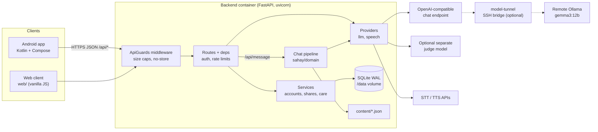

| Layer | Implementation |
|---|---|
| API | FastAPI app factory in [sahay/api/app.py](sahay/api/app.py); `python server.py` runs uvicorn |
| Domain | Pure-ish Python in `sahay/domain/`: safety, guard, pipeline, routing, content |
| Services | Account, share and care logic over SQLAlchemy sessions in `sahay/services/` |
| Providers | `urllib`-based OpenAI-compatible client and speech adapters in `sahay/providers/` |
| Storage | SQLite (WAL, FKs on) via SQLAlchemy 2.0; Alembic migrations |
| Content | Versioned JSON in `content/`, served at `/api/content` |
| Contract | `contract/openapi.json` snapshot; Android JVM tests consume real backend fixtures |

## 2. Backend layout

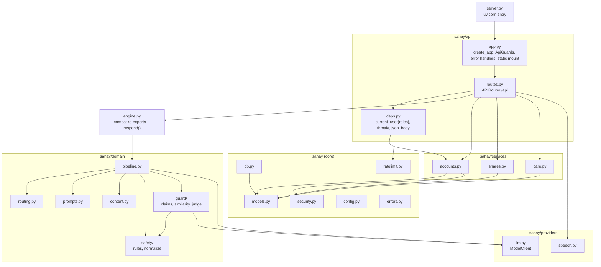

`engine.py` is a thin compatibility surface: `respond()` picks a model client (`model_for_request`) and calls `pipeline.run`. New code imports from `sahay.*`.

### Request lifecycle

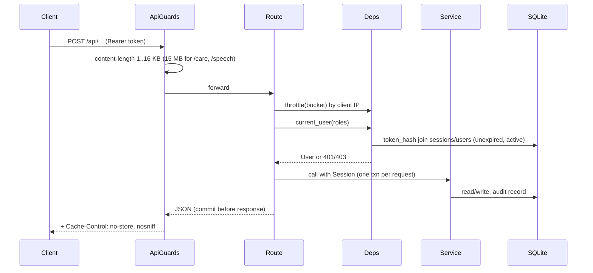

Errors use one envelope, `{"error": "..."}` (plus `retry_after` on 429). `ApiError`, validation, `ValueError`, JSON errors and unexpected exceptions all map to it; unexpected errors return a fixed message pointing to the Help panel, never the exception text.

## 3. The chat pipeline

`POST /api/message` → `engine.respond` → `pipeline.run`. One turn is: local safety → understand → safety gate → route → draft → localise → guard. Every model call shares one deadline (`SAHAY_TURN_DEADLINE`, default 45 s) via `BoundedModel`, so a slow provider degrades to curated copy instead of hanging.

Invariants, from the module docstrings:
- The model may only **raise** risk (`more_cautious`) and only choose among fixed tools (`reflect, coping, info, questions, activities, brief`).
- Nothing the model writes reaches the user unless the guard approves it. The guard never edits text; on failure the pipeline substitutes curated copy.

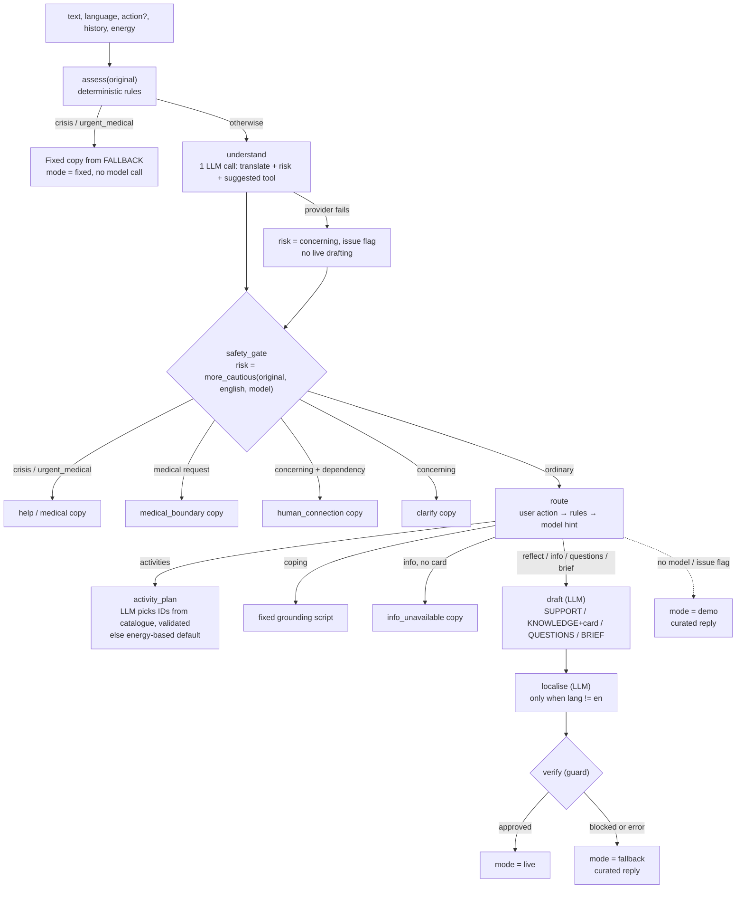

Ordinary live turn cost: understand (1) + draft (1) + translate (1, non-English) + judge (1).

Response shape: `route, action, text, card, mode (fixed|live|fallback|demo), translation, agent_trace[], orchestration, + optional activity_plan / suggestions / visit_brief / provider_error`. `agent_trace` lists named steps (Language, Safety, Supervisor, Knowledge, Emotional support, Activity, Visit preparation, Guard, Review) with `mode` of `llm`, `fixed` or `fallback`; the app shows these as "agent handoffs". They are labels over one pipeline, not separate agents.

### Safety layer — `sahay/domain/safety`

- `normalize.py`: lowercase, strip invisible chars and apostrophes, punctuation to spaces, collapse repeats, and repair typos against a small vocabulary (`kil` → `kill`).
- `rules.py`: regex groups for `CRISIS`, `MEDICAL` (urgent), `DEPENDENCY` and `MEDICAL_REQUEST`, in English, romanised Hindi, Devanagari, Bengali and Tamil (one script per pattern, enforced by tests).
- `assess(text)` runs on raw, normalised and typo-repaired views and returns `RiskAssessment(risk, medical_request, dependency, rules)`. Rule-group names only; never the user's text.
- Risk order: `ordinary < concerning < urgent_medical < crisis`.

### Output guard — `sahay/domain/guard`

Every model-written string passes three layers, cheapest first; all must pass.

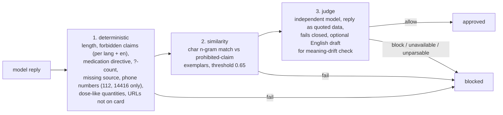

`judge_client()` uses `SAHAY_GUARD_LLM_*` if set (trace says `separate`), else the main model (`same_model`). For translated replies the English draft is also checked, since it must be clean before translation.

### Content — `content/*.json`

`sources.json` (curated NCI cards + translated summaries), `fallback.json` (fixed replies per language and situation), `activities.json` (catalogue with energy/minutes), `intros.json`. `content.py` loads them at import and computes `CONTENT_VERSION` (hash) so clients can detect stale bundled copies. `GET /api/content` returns the bundle; Android ships `assets/content.json` as the offline copy.

`india.json` holds Indian-context handling: keyword themes (family, faith/traditional remedies, care journey away from home, fasts/festivals) whose guidance is appended to the support prompt, per-language curated check-ins used as the offline reply for those themes (exposed as `checkins` in the bundle), and the cost-worry pattern that routes to the `financial` card in `sources.json` (PM-JAY, RAN, PMNRF; helpline 14555 is on the guard's number allowlist). The guard blocks remedies presented as cures or substitutes for treatment and fasting directives. Hindi, Bengali and Tamil copy and the scheme details need native-speaker and social-worker review.

## 4. Model provider handling — `providers/llm.py`

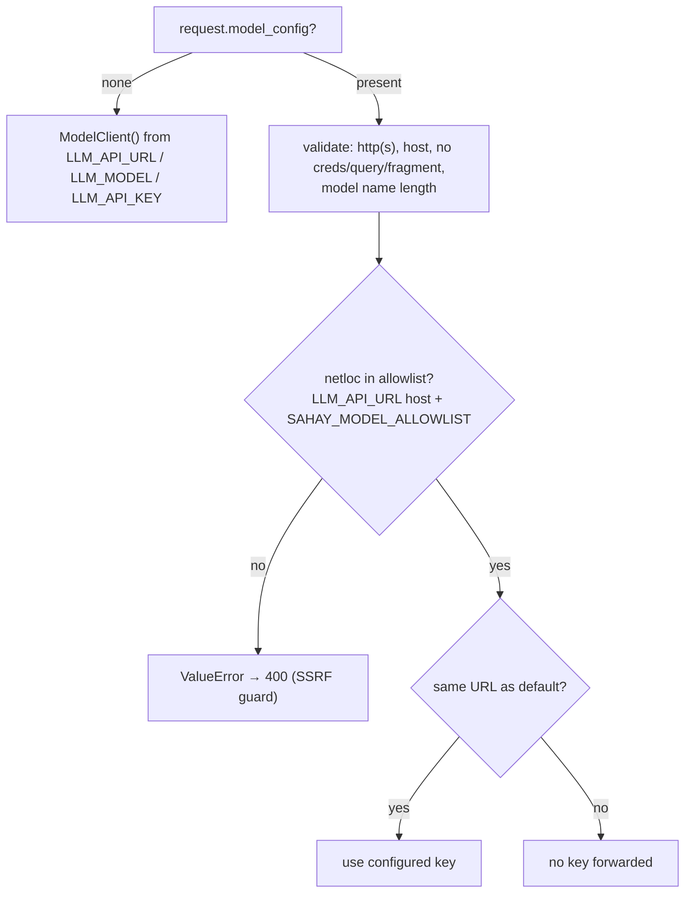

- Redirects are refused (`_NoModelRedirect`), request and provider error bodies are never logged or echoed (only HTTP status plus a fixed hint).
- `public_model_configuration()` strips credentials and query from the URL for `/api/health`.
- No `LLM_API_URL`/`LLM_MODEL` → `ready=False` → the pipeline runs in `demo` mode on curated copy.
- Speech (`speech.py`): OpenAI-compatible STT (`m4a` in) and TTS (`mp3` out) via `STT_API_URL` / `TTS_API_URL`; 503 when unconfigured, so the app falls back to device speech.

## 5. Accounts, sharing and care

### Roles and access

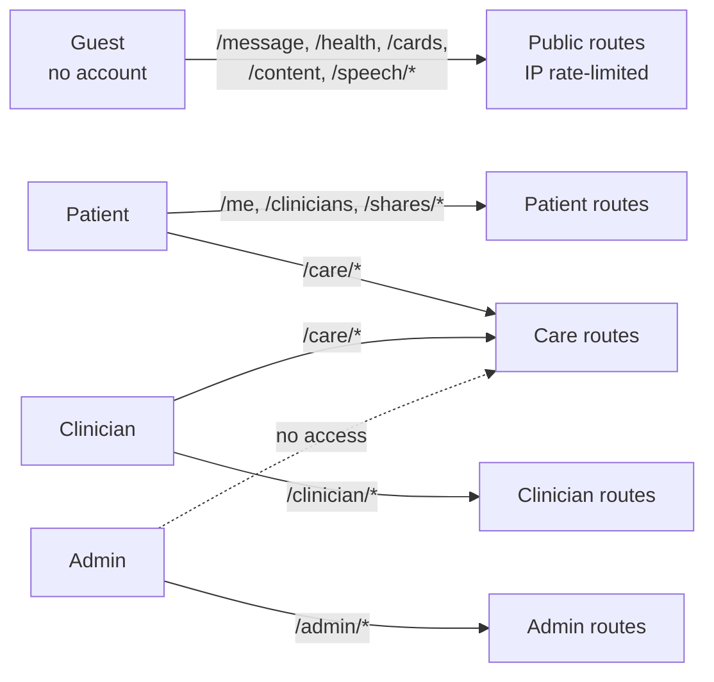

Routes declare access with `Depends(current_user("patient"))` etc. (`Patient`, `Clinician`, `Admin`, `Member`, `Anyone` in `routes.py`). There is no per-handler role check to forget.

### Auth

- Patients self-register (`/auth/register`); clinicians are created by admin invitation (`/admin/invitations` → `/auth/accept-invite`); admin accounts come from `python -m sahay.cli seed-demo`.
- Passwords: scrypt (n=2^14), constant-time compare. Session tokens: 32-byte URL-safe random, stored only as SHA-256; 12 h expiry; expired sessions pruned on each new login.
- Login failures are throttled per IP + contact (8 per 15 min); success resets the counter. Other buckets: message 30/min, model_test 5/min, speech 20/min, register 10/h. The limiter is in-memory and per-process.
- Every share, review, care message, invite and deactivation writes an `audit` row.

### Data model

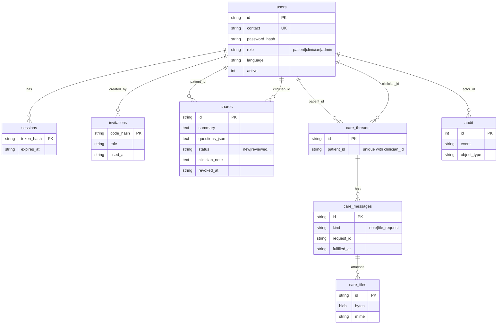

### Visit-brief sharing

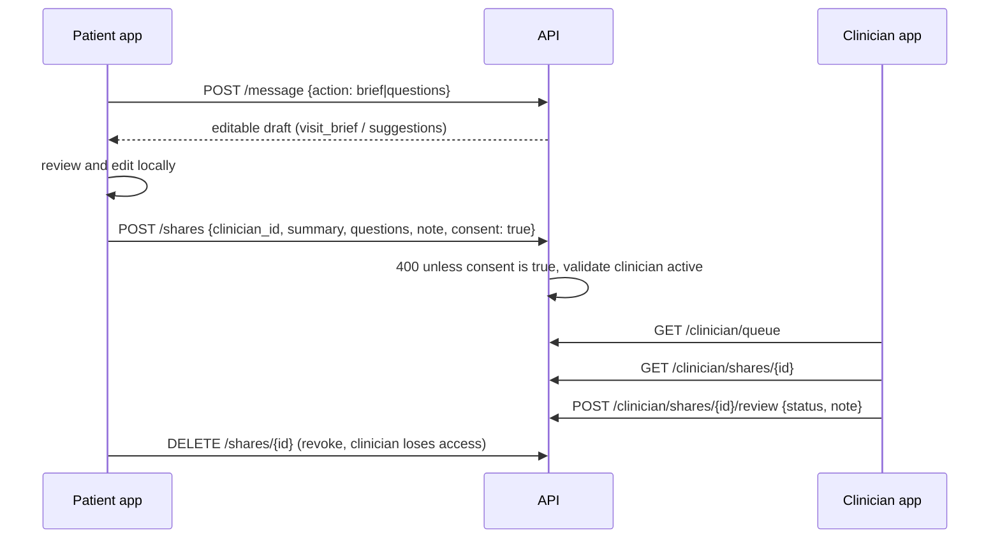

Nothing is shared until the patient explicitly consents to a specific clinician.

### Care conversations

One thread per patient–clinician pair (unique constraint). Messages are `note` or `file_request` (clinician only). Up to two files per message, up to 15 MB request body, stored as blobs with magic-byte checks; a patient can fulfil an open request by posting a file with `request_id`, which sets `fulfilled_at`. Only thread members can read messages or download files.

## 6. Android client

Single-activity Kotlin / Jetpack Compose app, package `org.sahay.app`.

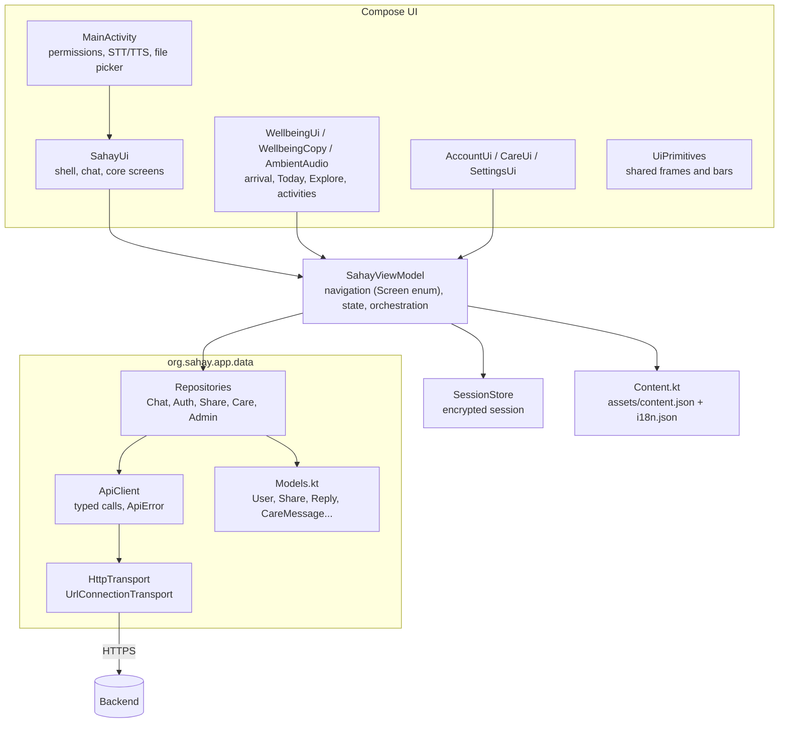

- **Transport seam:** `HttpTransport` is the only code touching the network, so `ApiClient` and repositories run in plain JVM tests with a fake transport. `ApiError(status, message, retryAfterSeconds)` has `isOffline` (status 0), `isUnauthorised`, `isRateLimited`.
- **Contract tests:** `ContractTest` and `ApiClientTest` parse JSON fixtures under `android/app/src/test/resources/contract/`, generated from the real backend by `tools/export_contract_fixtures.py`. CI fails if they drift.
- **Role routing:** saved session → `/api/me` → role home (patient: Today/Talk/Explore/Care/Settings; clinician: Review/Messages/Settings; admin: accounts, invitations, audit). Invalid session returns to account entry; network failure offers retry/sign-out.
- **Offline behaviour:** activities, language assets and fixed replies are bundled; the app can fall back client-side when the server is unreachable.
- **Known debt:** `SahayViewModel` is ~900 lines and owns navigation, auth, care, admin, speech and settings. The data layer is already split out; the view model has not been.

## 7. Web client

`web/` (`index.html`, `app.js`, `i18n.js`, `styles.css`, Noto fonts for the four scripts) is served by FastAPI's `StaticFiles` at `/`. It is a second client of the same API with local history and settings in `localStorage`. The Android app is the primary product UI.

## 8. Deployment

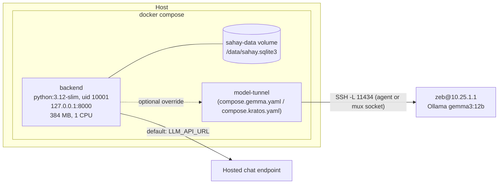

- `init_db()` runs on app startup: fresh DBs get `alembic upgrade head`; legacy DBs (have `users`, no `alembic_version`) are filled in with `create_all` and stamped, never altered.
- Operator CLI: `python -m sahay.cli seed-demo | migrate | openapi`.
- The tunnel variants publish no model port; `compose.gemma.yaml` uses an SSH agent socket, `compose.kratos.yaml` reuses an existing SSH mux with `socat`.
- Behind a reverse proxy, set `SAHAY_TRUST_PROXY=1` so rate limits use `X-Forwarded-For`.

### Configuration

| Variable | Purpose |
|---|---|
| `LLM_API_URL`, `LLM_MODEL`, `LLM_API_KEY`, `LLM_TIMEOUT` | Main chat model; unset = demo mode |
| `SAHAY_TURN_DEADLINE` | Per-turn budget across all model calls (default 45 s) |
| `SAHAY_GUARD_LLM_API_URL/_MODEL/_API_KEY` | Separate judge model (recommended) |
| `SAHAY_MODEL_ALLOWLIST` | Extra endpoints a device may select |
| `STT_API_URL/_KEY/_MODEL`, `TTS_API_URL/_KEY/_MODEL/_VOICE` | Speech adapters |
| `SAHAY_DB_PATH`, `SAHAY_HOST`, `SAHAY_PORT`, `SAHAY_TRUST_PROXY` | Server |

## 9. Testing and CI

| Area | Tests |
|---|---|
| Safety | `test_safety_corpus.py` over `tests/data/safety_corpus.json` (labelled multilingual cases) |
| Guard | `test_guard.py` (deterministic, similarity calibration with a benign set, judge), `test_output_filter.py` |
| Pipeline | `test_pipeline.py`, `test_engine.py`, `test_agents.py` |
| API | `test_api_contract.py`, `test_accounts_api.py`, `test_care_api.py`, `test_speech.py`, `test_model_configuration.py` |
| Content | `test_content.py` |
| Contract | `test_openapi_contract.py` vs `contract/openapi.json` |
| Android | JVM tests `ApiClientTest`, `ContractTest` |

CI (`.github/workflows/ci.yml`): `ruff check` → `pytest` → OpenAPI snapshot diff → Android fixture diff → `./gradlew :app:testDebugUnitTest`.

## 10. Design decisions worth keeping

1. **Deterministic safety first.** Explicit crisis/urgent text is answered by local rules before any model call, so a slow or down provider cannot delay help.
2. **Model can only escalate.** Risk is a max over rule and model views; routing is limited to a fixed tool set.
3. **Fail closed, fixed copy.** Guard failure, provider failure or deadline expiry all land on reviewed copy in the user's language, never on unreviewed text.
4. **Consent-gated sharing.** Briefs are drafts until the patient picks a clinician and confirms; revocable.
5. **No content logging.** Request bodies and provider error bodies are not logged or echoed; safety rules report group names only.
6. **SSRF-closed model selection.** Devices can only pick endpoints the operator allow-listed, and secrets are never forwarded to a different URL.
7. **Structural authorisation.** Role requirements live in route dependencies; ownership checks are in the service queries.

## 11. Known gaps

- `Dockerfile` still does `COPY ... agents.py ...`, but `agents.py` no longer exists on this branch, so the image build will fail until that name is removed.
- Rate limiting and login throttling are in-memory and per-process; multi-process deployment needs a shared store.
- `test_agents.py` and the `AGENTS` list/`orchestration` string keep the older "eight agents" naming, although the implementation is one explicit pipeline.
- Care files are stored as blobs in SQLite; fine for the prototype, not for volume.
- `SahayViewModel` is a large single class (see section 6).
- `web/app.js` carries its own copy of card text and translations, separate from `content/`.
