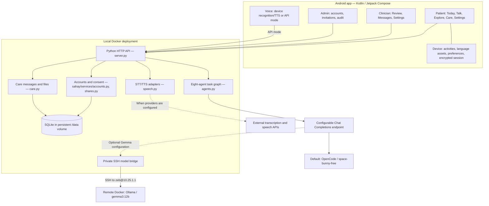
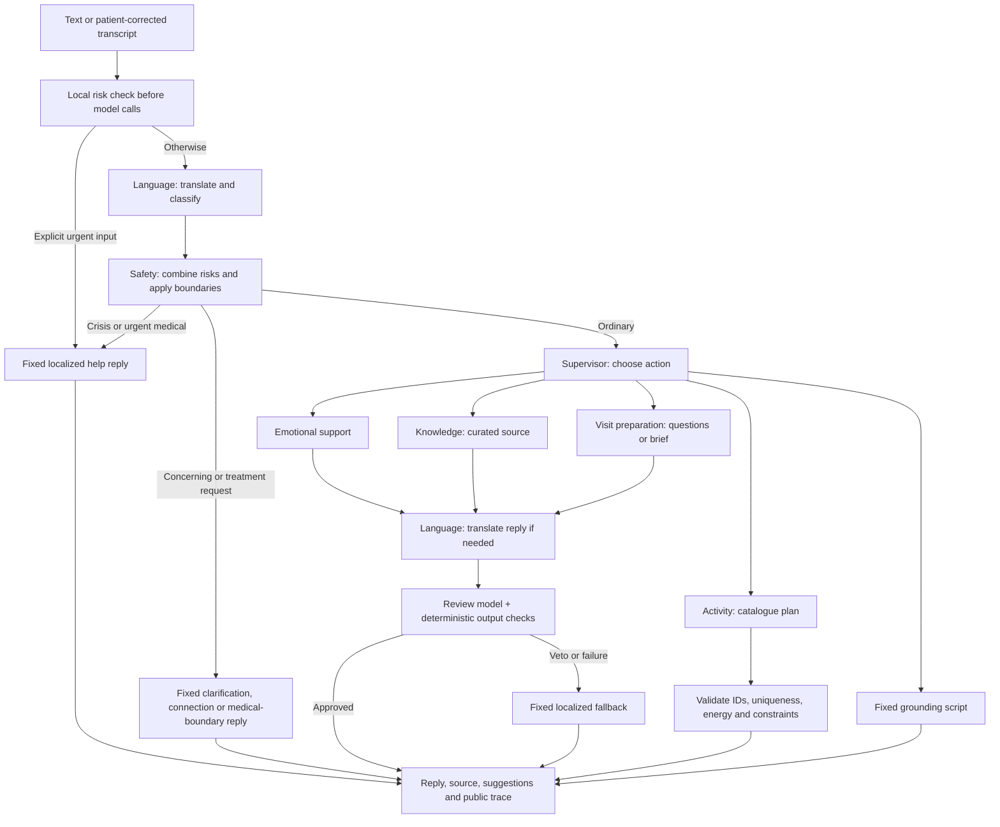

# Sahay — updated system architecture

Updated: **12 October 2026**. This document describes the current implementation. Pending integrations are listed separately in section 9.

Sahay is an **Android emotional wellbeing course prototype for adults affected by cancer in India**. It combines a calm native interface, optional recreational activities, multilingual support, a bounded multi-agent assistant, and patient-controlled communication with a fictional care team.

## 1. System overview



| Layer | Current implementation |
| --- | --- |
| Main client | Native Kotlin, Jetpack Compose, Material components; Android only |
| Client state | `SahayViewModel`, Compose observable state, bundled content and Android preferences |
| Backend | Python standard-library `ThreadingHTTPServer`; JSON HTTP API |
| Agent orchestration | Custom request-scoped graph with eight specialist agents; no LangGraph dependency |
| Model | Shared selected model through an OpenAI-compatible endpoint; default `space-bunny-free`, optional `gemma3:12b` |
| Backend storage | SQLite: accounts, sessions, invitations, approved shares, care conversations/files, audit |
| Deployment | Backend container with hosted model endpoint; optional SSH bridge for remote Gemma |
| Languages | English, Hindi, Bengali and Tamil (`en`, `hi`, `bn`, `ta`) |

The earlier web prototype remains served by the backend. The current product UI and activities are in the Android app.

## 2. Android application architecture

### Screens and role routing

- **Guest/patient:** interactive garden arrival → Today; bottom destinations are Today, Talk, Explore, Care and Settings. Today starts with one optional breathing invitation, followed by an expandable mood/energy check-in and activity plan.
- **Clinician:** sign-in/session restoration → review queue; separate Review, Messages and Settings destinations. Detail screens display patient-selected briefs and questions, with manual review status and notes.
- **Admin:** account list, clinician invitations, deactivation and audit metadata. Admin accounts have no care-message/file access through the care API.
- **Settings:** full screen for identity, display name, password, sign-out, language, larger text, reduced motion, volume, speech provider, local saving, clearing local data, support, connection settings and the latest agent handoffs.

Saved sessions are checked through `/api/me` before restoring the matching role home. Invalid sessions return to account entry; connection failures show retry/sign-out controls. Back and Help return to their originating screen.

### Client layers

| Responsibility | Source |
| --- | --- |
| Permissions, speech, document picker, file opening/export | `MainActivity.kt` |
| Navigation, observable state, HTTP requests, sessions, client fallback | `SahayViewModel.kt` |
| Patient shell, chat and core screens | `SahayUi.kt` |
| Arrival, Today, Explore and activities | `WellbeingUi.kt`, `WellbeingCopy.kt`, `AmbientAudio.kt` |
| Accounts, clinician/admin, care and settings | `AccountUi.kt`, `CareUi.kt`, `SettingsUi.kt` |
| Shared spacing, app bars, page frames and bottom actions | `UiPrimitives.kt` |
| Bundled multilingual copy, sources and fixed replies | `Content.kt`, `assets/content.json`, `assets/i18n.json` |
| Session encryption | `SessionStore.kt` |

Activity controls and the care composer use persistent bottom action areas above the keyboard and system insets. Scrollable content is separate. Shared controls use 48dp icon targets, 56dp primary actions and consistent spacing. See [UI_REFINEMENT.md](UI_REFINEMENT.md) for design decisions and rendered checks.

### Local activities

Nine activities run on the device without requiring the LLM:

1. Gentle breathing, with start/pause and optional stopping.
2. Five-senses grounding with step-by-step progression.
3. Guided quiet/meditation moment.
4. Locally generated rain, white noise and brown noise.
5. Garden matching pairs.
6. Colour hunt.
7. Drawing canvas with undo and PNG export.
8. Private journal with optional local saving.
9. Explicitly fictional encouragement notes.

The Activity agent recommends catalogue entries; it does not generate executable games or exercise instructions. Timers/audio respect leaving the activity and backgrounding. There are no wellbeing streaks or performance scores.

## 3. Multi-agent backend

### Agent responsibilities and authority

Eight agents share the selected model and a request-scoped state. Each has separate instructions and code-controlled operations. Safety is deterministic; the other agents combine model calls with fixed validation or fallback behavior.

| Agent | Responsibility | Available operations |
| --- | --- | --- |
| Language | English working translation, initial model risk classification, reply translation | Translate/classify input; translate output |
| Safety | Combine original-text rules, translated-text rules and model risk; stop unsafe routes | Risk gate; fixed help, clarification, medical-boundary or human-connection reply |
| Supervisor | Select a permitted specialist action | Delegate to `reflect`, `coping`, `info`, `questions`, `activities` or `brief` |
| Emotional support | Acknowledge a concern and ask a relevant question | Draft a short reflective reply |
| Knowledge | Explain an available curated source summary | Lookup one of four cards; draft a cited explanation |
| Activity | Select an optional plan suited to stated energy | Choose 1–3 catalogue IDs, checked by code |
| Visit preparation | Prepare care-visit questions or a first-person brief | Produce an editable draft from supplied context |
| Review | Check generated output for fidelity and allowed content | Approve or veto; fixed fallback on veto/failure |

Operations are Python methods controlled by the graph. The model cannot execute arbitrary tools, read the database, send care messages/files, change accounts or contact a clinician. A turn executes a bounded sequence of handoffs, without an autonomous background loop.

### Turn execution



The graph does **not** call all eight agents on every turn:

- Reflection: Language → Safety → Supervisor → Emotional support → output translation if needed → Review.
- Activity plan: Language → Safety → Supervisor → Activity → catalogue validation. Its introduction uses fixed localized copy; this path skips the generative Review step.
- Brief: Language → Safety → Supervisor → Visit preparation → output translation if needed → Review → patient editing. Sharing is a separate authenticated action.
- Explicit urgent wording recognized by local rules: immediate fixed Safety response, skipping model calls.

### State, context and response contract

The actual `State` holds request data, model client, original text, language, English translation, risk, action, provider issue flag, public trace and task-specific extras. It exists only for the request.

Android normally supplies the last four displayed messages as recent conversation context. Visit preparation also includes the patient's concerns/questions. There is no backend longitudinal patient-memory store or inferred emotional profile.

`POST /api/message` returns:

```json
{
  "route": "ordinary",
  "action": "reflect",
  "text": "...",
  "card": null,
  "mode": "live",
  "translation": "English working text",
  "agent_trace": [{"agent": "Supervisor", "tool": "delegate", "outcome": "reflect", "mode": "llm"}],
  "orchestration": "sahay-agent-graph-v1"
}
```

Task-specific fields include `activity_plan`, `visit_brief` and launchable `suggestions`. The trace exposes tool decisions rather than hidden reasoning; Android shows the latest chat/plan trace under AI activity.

`mode` distinguishes model-approved output (`live`), fixed routing (`fixed`), deterministic demo behavior (`demo`) and failure/veto fallback (`fallback`). Activity plans can be `live` when the model selects valid IDs, even though their introductory text is fixed.

Knowledge uses four bundled source cards, without a vector database or open-web RAG. Unknown topics return fixed unavailable-information text. Rule checks and model review do not guarantee correct interpretation of novel input.

## 4. Indian languages and speech

### Language flow

The selected language is saved in device preferences and changed in Settings. Core UI/help/account controls, activity labels and principal exercise guidance are bundled in English, Hindi, Bengali and Tamil. Secondary explanations and clinician/admin interfaces remain English-first.

For a live ordinary turn, the selected model creates an English working translation, a specialist drafts the answer, and Language translates it to the selected language. Safety checks both original and translated input. Review compares the final answer against the draft, including urgency and negation. AI translation uses the shared model; there is no separate external translator service.

Mixed-language input is accepted as text, but code switching, accents and translation accuracy still need broader bilingual evaluation. The implementation does not retain word-level language spans, ASR confidence or a clinical distress score.

### Speech flow

```text
Microphone
  ├─ Device mode → Android recognition service
  └─ API mode → AAC/M4A clip → backend STT adapter → configured provider
       ↓
Editable transcript → explicit Send → agent graph → readable reply
       ↓
Optional playback → Android TTS or backend TTS adapter → MP3
```

- Device recognition/TTS depend on installed Android services and available language voices.
- API mode is wired, but real STT/TTS providers have not been supplied.
- Transcription accepts up to 8 MB of audio and forwards an OpenAI-compatible multipart request with model, language and file.
- Synthesis forwards text/model/voice and returns MP3. It relies on the provider understanding the input script; a provider requiring an explicit language parameter needs an adapter adjustment.
- API recording clips are deleted after completion/cancellation. Transcripts are shown for correction before sending. Denied permissions and missing providers retain text input/readable replies.
- Provider URLs/credentials stay on the backend. Device speech may use its installed service's network processing; it is not guaranteed to be offline.

## 5. Clinician handoff and two-way care communication

### Patient-approved visit brief

1. Patient writes concerns/questions or requests an AI draft.
2. Patient edits the draft, selects questions, chooses a clinician and explicitly confirms consent.
3. Backend stores a snapshot in `shares` and records an audit event.
4. The selected clinician sees it in the review queue and can mark `in_review` or `reviewed`, with a note.
5. Patient can revoke the share. Subsequent clinician API reads are blocked and it leaves the queue.

Only selected brief/questions/note are shared. Ordinary chat and journal content are not automatically copied into this workflow. Revocation blocks future app access; it cannot erase information already viewed or copied by a recipient.

### Care messages, files and requests

Care communication is independent of visit-brief sharing:

- One thread joins one patient and one clinician. Either can open it from the synthetic opposite-role directory.
- Both can send notes/files without waiting for a request.
- Clinicians create `file_request` messages. Patients attach a reply using `request_id`; storing the reply and fulfilling the request occur in the same database transaction.
- Accepted formats: PDF, PNG, JPEG and UTF-8 text; up to two attachments per API message, each at most 5 MB. Android currently holds one pending attachment.
- Files are SQLite BLOBs, downloaded through authenticated participant checks and opened/exported through Android file APIs.
- Authorization checks session, role, thread membership and active partner status. Sending/downloading produces audit events.

Files are **not** automatically interpreted by the LLM. Care uses manual fetch/refresh, without push notifications or emergency monitoring. Brief revocation does not revoke independently sent care files; there is no unsend. The course directory is not a verified hospital patient-assignment system.

## 6. Accounts, storage and access

### Bookkeeping

Patients can register; clinicians accept admin-created invitations or use seeded fictional accounts. Invitations are returned to the admin for manual sharing, without automatic email delivery. Admins are provisioned through demo seeding. Sessions expire after 12 hours. Password changes invalidate all account sessions; deactivation also invalidates sessions.

Passwords use salted `scrypt`; bearer tokens and invitation codes are hashed in SQLite. Android stores its session bundle with AES-GCM using Android Keystore and checks the server session on launch. Backend handlers enforce role authorization independently of navigation.

### Persistence

| Data | Location and retention |
| --- | --- |
| User profile/role/active status | SQLite `users` |
| Hashed sessions and expiring invitations | SQLite `sessions`, `invitations` |
| Shared brief, review status/note and revocation | SQLite `shares`; submission/status events in `audit` |
| Care messages, request status, attachments | SQLite `care_threads`, `care_messages`, `care_files` |
| Account/share/care event metadata | SQLite `audit`; admin API returns latest 100 entries |
| Ordinary AI chat, visit questions, journal | Device memory by default; opt-in device preferences for local saving |
| Language, accessibility, audio, connection preferences | Android preferences |
| Unsent care draft and pending attachment | ViewModel memory; retained for the same thread during the session, cleared on thread change/sign-out/local clear |
| Agent state/trace | Request memory and latest client state; no durable backend trace store |

Only the session bundle is encrypted by `SessionStore`; opt-in saved conversation/question/journal preferences are not separately encrypted by the app. Sign-out/local clear remove local sensitive content, without deleting previously submitted backend shares or care messages.

Message and speech endpoints support guest use and currently do not require account tokens. Account, share, clinician/admin and care operations require authorization. The server does not durably store ordinary AI transcripts; configured model/speech providers process supplied text/audio under their own behavior.

## 7. API boundaries

| Area | Routes |
| --- | --- |
| Assistant/content | `POST /api/message`, `POST /api/model/test`, `GET /api/cards`, `GET /api/health` |
| Authentication | `POST /api/auth/{register,login,accept-invite,logout}` |
| Account | `GET /api/me`; `POST /api/me/profile`, `/api/me/password` |
| Patient sharing | `GET /api/clinicians`; `POST /api/shares`; `GET /api/shares/mine`; `DELETE /api/shares/{id}` |
| Clinician review | `GET /api/clinician/queue`, `/api/clinician/shares/{id}`; `POST /api/clinician/shares/{id}/review` |
| Care | `GET /api/care/contacts`; `GET/POST /api/care/threads`; `GET/POST /api/care/threads/{id}/messages`; `GET /api/care/files/{id}` |
| Administration | `POST /api/admin/invitations`; `GET /api/admin/users`, `/api/admin/audit`; `POST /api/admin/users/{id}/deactivate` |
| Speech | `GET /api/speech/status`; `POST /api/speech/transcribe`, `/api/speech/synthesize` |

Android **Settings → AI model** saves a per-device endpoint URL and model name. `model_config: {url, model}` selects that client for the whole graph without changing the backend default or another device. **Save and test model** calls `/api/model/test` for a real short request. Credentials remain on the backend, are attached only to its exact configured endpoint, and are not forwarded on redirects. The current requested OpenCode free-tier endpoint returns HTTP 403 outside OpenCode; live access is pending provider authorization.

`/api/health` exposes the credential-free default URL/name and reports whether they are configured; its `live` flag does not prove current model connectivity. Speech status likewise reports configuration presence.

## 8. Deployment and failure handling

### Course deployment

- **Backend:** `Dockerfile`, Python 3.12, nonroot UID 10001, health check, 384 MB memory cap, 1 CPU; persistent `sahay-data` volume at `/data`.
- **Host access:** `127.0.0.1:8000`; emulator reaches it at `10.0.2.2:8000`.
- **Model:** optional `compose.gemma.yaml` runs a 64 MB SSH bridge, forwarding private Docker-network traffic to the authorized host's loopback Ollama service. The recorded demo uses existing remote container `resume-ollama` and `gemma3:12b`.
- **SSH:** bridge mounts the current SSH agent socket and trusted `known_hosts`, without copying a private key. A restarted agent needs its socket configuration refreshed. No model port is published to the host/LAN by the bridge.
- **Configuration:** `LLM_API_URL`, `LLM_MODEL`, optional `LLM_API_KEY`, `LLM_TIMEOUT`; speech uses `STT_*` and `TTS_*` variables. Secrets belong in ignored `.env`, not source or Android assets. The current default is `https://opencode.ai/zen/v1/chat/completions` / `space-bunny-free`; the optional Gemma Compose file explicitly overrides it.

```bash
# Backend without the optional model bridge:
docker compose up -d --build

# Model-enabled setup, from a terminal with the SSH key loaded:
export SAHAY_SSH_AGENT="$SSH_AUTH_SOCK"
docker compose -f compose.yaml -f compose.gemma.yaml up -d --build
```

Unset live-model settings to select deterministic demo behavior. Remote inference keeps large model-memory requirements off the development PC. Build Android with the emulator closed after the earlier OOM; see [android/README.md](android/README.md) for the constrained modern-phone emulator setup.

### Failure behavior

- Explicit urgent input recognized by local rules gets a fixed reply before slow model calls.
- Missing model configuration uses deterministic backend replies. Invalid output, provider failure or review veto selects a fixed fallback.
- Backend disconnection leaves local activities available and uses bundled client chat fallbacks; care/account submissions require a successful server response.
- Missing speech configuration returns 503 with readable text retained.
- Model timeouts are per call; several sequential calls can exceed the Android chat timeout. A whole-turn deadline/cancellation mechanism is not implemented.
- This deployment uses local HTTP. Hosted TLS and production operations are outside the current course setup.

## 9. Implemented versus pending

| Implemented | Pending or outside current scope |
| --- | --- |
| Native patient/clinician/admin flows, full Settings, role restoration | Real identity verification, hospital assignments, EHR integration |
| Eight-agent delegation, public handoffs, fixed safety routes, output review | Clinical efficacy validation and broader independent safety evaluation |
| Four-language text support and AI translation | Bilingual review of all copy, wider code-switching/accent tests |
| Device speech hooks and HTTP STT/TTS adapters | Real speech API credentials, voice quality and microphone/device validation |
| Nine local activities and constrained AI recommendations | Live peer community/moderation; current notes are fictional |
| Two-way files, clinician requests, approved briefs and audit | Malware scanning, unsend, push messaging, automatic file interpretation |
| Persistent Docker backend and private model bridge | Production hosting, automated backups, rate limits, whole-turn cancellation |

## 10. Recorded validation

These are existing implementation records, not tests rerun for this documentation update:

- [OVERHAUL_VALIDATION.md](OVERHAUL_VALIDATION.md): 31 Python tests; Docker account/file/request flows and persistence; **22/22 authored fictional Gemma cases** passing the recorded checks. The model artifact is [evals/overhaul_gemma_results.json](evals/overhaul_gemma_results.json), recorded 4 October 2026 UTC / 5 October IST. Earlier routing failures and focused rechecks remain in `evals/`.
- [UI_REFINEMENT.md](UI_REFINEMENT.md): successful APK build, installed emulator checks, role/session restoration, keyboard/composer behavior, local activities and compact Tamil navigation with larger text.
- Speech provider tests use mocks; these results do not establish actual recognition/playback quality or clinical performance.

### Relationship to the supplied architecture

The original diagram's supervisor, specialist support, safety, context and clinician-review ideas remain. They are implemented as a bounded request graph, short client-supplied context and explicit patient-approved submissions. Passive clinical monitoring, vitals ingestion, autonomous treatment, an EHR and a vector retrieval service are not implemented.

Original project resources remain in [resources/](resources/): the supplied clinical escalation diagram, MindfulAgents material, agentic psychiatry perspective, oncology chatbot review and India IGAP report. They informed the earlier architecture review; this update is grounded in the current source and recorded validation.

### Model selection update - 12 October 2026

The Android model fields apply to conversations, translation, plans and briefs. Provider errors are returned separately from fallback content and shown in Settings/the app. Direct OpenCode testing returned HTTP 403 (standalone free-tier access restricted); successful Space Bunny responses have not been validated. Earlier Gemma results above remain historical evidence for that model. The exported architecture PDF is the 5 October snapshot.
