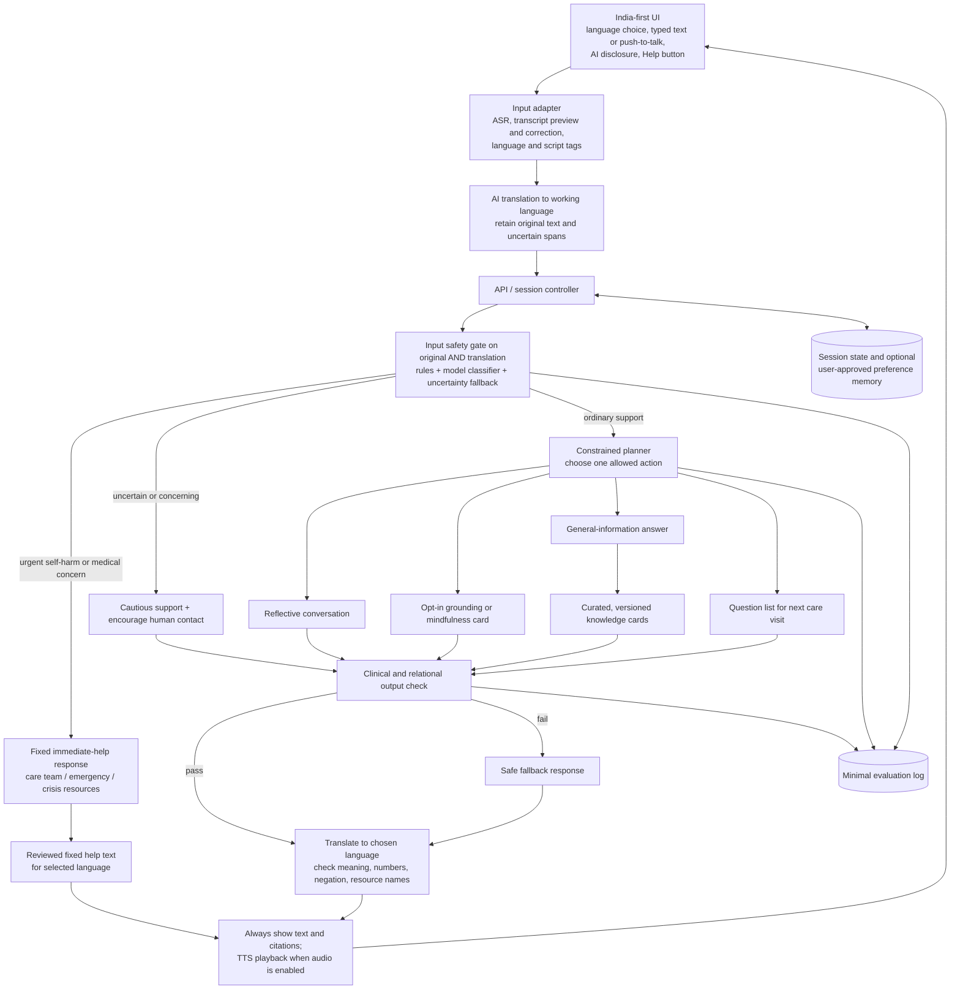

# Agentic AI for emotional wellbeing in people affected by cancer

## Project decision

Build an **India-first, speech-and-text, adult-only course prototype** for people living with cancer. The first release supports **Hindi, Bengali, and Tamil**, plus English; users may mix English with an Indian language in speech or writing. The assistant helps a user name a concern, choose a small coping action, find trustworthy general information, and prepare to talk to a person on their care team. It has no diagnostic or treatment authority. All evaluation uses fictional cases; the prototype is not presented as a clinical service.

The agentic element is a bounded plan over several steps: understand the user's goal, choose one allowed support action, use a curated source when factual information is needed, check the response, and update only user-approved memory. The route can change as the conversation changes. This is more defensible than a collection of unrestricted agents with clinical-sounding job titles.

## Why change the supplied diagram?

The supplied architecture has a useful core: distinct support tasks, retained context, and escalation. The changes below address its main implementation and evaluation gaps.

| Supplied component | Decision for this prototype | Reason |
| --- | --- | --- |
| Text, voice, vitals ingestion | Typed input and push-to-talk voice in Hindi, Bengali, Tamil, and English; no vitals | Make speech useful for Indian-language access while keeping transcript review and explicit safety checks. Do not infer emotion or clinical state from voice tone. |
| Central graph state with patient memory and clinical context | Explicit session state plus small, editable preference memory | Avoid implying access to reliable medical records or building an opaque psychological profile. |
| Supervisor and three broad agents | Deterministic safety gate followed by one constrained planner and a small set of actions | Fewer model calls, clearer control flow, measurable routing decisions. |
| Clinical summarizer | **Patient-owned question list / visit summary** | No clinician documentation claim without a clinician workflow. |
| Continuous affective/symptom monitor | Optional self-report check-in within the session | No passive monitoring or inference of clinical change. |
| Semi-autonomous therapeutic intervention | Short, opt-in coping exercises from fixed, reviewed templates | Avoid claiming to deliver therapy. The model may adapt wording, not the core instruction. |
| Safety guardrail after agents | Input safety gate **before** planning, plus output check before display | Unsafe content must not wait for an agent to recognize it. |
| Clinician dashboard and EHR | Synthetic demo review queue only if time permits; no EHR | A dashboard without a staffed recipient must never be described as actual escalation. |
| General psycho-oncology RAG | Small, versioned, cited knowledge cards from authoritative sources | Research papers and free-form retrieval are unsuitable as direct patient instructions. |
| English-only reasoning or output | Translation layer with source-language safety checks and translated answers | A translated English paraphrase can lose negation, urgency, or culturally specific expressions of distress. |

## Proposed architecture



The **Help** button is available on every screen and bypasses speech recognition, translation, and the model. The translation adapter passes both the original text and its working translation to the controller; on translation failure it passes the original with an `uncertain` flag. The input gate runs on every turn, including after earlier low-risk turns. It reads the source-language transcript **and** the English working translation when available; either can trigger the more cautious route. The output check catches unsupported clinical statements, missing source links in factual answers, false claims that a person has been alerted, excessive intimacy, and instruction to ignore medical advice. The translated response then gets a second check for changed meaning, negation, numbers, and emergency instructions. A failed check gets one safe fallback, not an unbounded retry loop. If any provider is unavailable, the UI still shows the Help button and a typed-input fallback.

### Language and speech pipeline

1. At onboarding, the user selects **Hindi, Bengali, Tamil, or English** and can change it at any time. Provide native-script labels and a clear English label; do not infer language from a name, location, or accent. Hinglish and other code-switched messages can be entered under either relevant language setting.
2. Typed text goes directly to the input adapter. Voice uses **push-to-talk**, then speech-to-text (ASR). Show the recognized transcript in the user's selected script with borrowed words visible, allow editing, and require the user to send it. No continuous microphone or emotion detection from vocal features. When ASR is uncertain, ask for correction or typing; if it has detected possible urgency, show the Help panel immediately while awaiting confirmation.
3. Keep the original text, any corrected transcript, language tags, and the translated working text together for that turn. AI translation may help the planner, but the safety gate checks both versions. Preserve quoted words, medicine names, time, negation, and statements about self-harm or immediate symptoms. A disagreement routes cautiously and is logged for review.
4. Generate the content in a controlled working language, then translate to the selected language. Keep source links and emergency numbers outside free-form translation. Check the final translated text before display. Show text and citations even when audio is enabled; TTS reads only the checked text in voice mode. The user can pause, replay, slow, or turn off audio.
5. Prewrite short help and urgent-response messages in all supported languages and have **bilingual student reviewers** check them before the demo. These messages must work without generative translation or TTS. Never make a live AI translation the sole carrier of a crisis instruction.

AI4Bharat is one possible source of Indian-language ASR, machine translation, and TTS models; a hosted provider is also acceptable. Put these behind three replaceable adapters (`transcribe`, `translate`, `speak`) and check actual quality and latency on your test set before choosing one. This architecture does not require three separate LLMs or a new vector database.

### India-first interaction design

- Offer plain-language examples involving travel to a treatment centre, cost, family conversations, work, and uncertainty after diagnosis. Ask which concern applies instead of assuming a particular family structure, religion, income, or cancer type.
- Match the user's chosen language and informal or formal register. Test native scripts, Latin-script Hindi, code switching, accents, and borrowed medical words such as “chemo.” Do not translate an English-speaking user's answer into a formal language they did not choose.
- Keep a visible **private mode**: no spoken playback by default, headphones reminder when audio is enabled, and a quick way to clear the screen/session. A user may be sharing a phone or be near family members.
- Design for common phone use: large tap targets and text, short audio clips, low-bandwidth loading states, and no required account for the demo. Keep typing, captions, and the Help panel usable when microphone permission or connectivity fails.
- The Help panel shows India-relevant resources with readable local-language labels. It can include **112** for immediate emergencies, **Tele-MANAS 14416** for mental-health support, and a user-entered oncology-team number. It must never suggest that the app has called anyone.

### Allowed actions and boundaries

1. **Reflect:** acknowledge the expressed feeling, ask one open question, and avoid reassurance about prognosis or treatment.
2. **Offer a coping card:** invite the user to choose a brief grounding, breathing, or reflection exercise. Skip body-focused exercises if they feel uncomfortable; always offer a stop option. The exercise steps come from fixed cards; personalization is limited to the user's chosen topic and tone.
3. **Answer a general question:** retrieve from a curated NCI/WHO or locally approved card, cite the exact source and date, say when information is general, and suggest the oncology team for personal decisions. No medication, dosage, prognosis, diagnosis, or treatment-plan advice.
4. **Prepare human contact:** turn the user's concerns into questions they can ask their oncology team, counselor, trusted person, or support service. The user edits and exports the list; the app does not send it.
5. **Escalate visibly:** for self-harm language, immediate danger, or concerning medical symptoms, interrupt the normal agent workflow. Give brief, concrete next steps and locally relevant resources. Do not claim a clinician was notified. Medical concerns go to the oncology team or urgent care as appropriate; mental-health crisis concerns go to emergency or crisis support. Ambiguous cases receive a cautious response and are included in evaluation, not silently treated as low risk.

The resource panel and escalation path use the same verified India contacts. The team number is user-entered and is never invented by the model. General information cards may come from an international medical source, but the answer should distinguish general guidance from the user's own treatment plan and use India-relevant examples where available.

### Session and data model

Use a compact typed state rather than putting the whole transcript in every prompt:

```text
session_id, input_mode, selected_language, detected_language_spans,
asr_transcript, corrected_original_text, working_translation,
translation_uncertainty, current_message, last_few_turns,
user_goal, chosen_action, risk_route, risk_reason,
retrieved_card_ids, working_response, translated_response,
output_check, translation_check, audio_enabled,
approved_preferences {language, script, preferred_name, coping_preferences},
consent_to_save_preferences
```

For the course demo, use fictional personas and synthetic transcripts/recordings. Do not upload actual patient records or build an EHR connector. Keep recorded audio only long enough to transcribe it for the current turn, then delete it; do not store voiceprints. Store preferences only with an explicit opt-in; give an obvious edit/delete control. Store minimal event logs for evaluation (case ID, language, input mode, route, source IDs, check result, latency), with no raw distress disclosures by default. Avoid analytics that reward long conversations or daily engagement.

## Safety route specification

| Input | Route | Required visible behavior |
| --- | --- | --- |
| Ordinary worry, loneliness, uncertainty | Support | Brief empathetic response; user chooses reflect, coping, information, or visit questions. |
| “You are the only one I can talk to” or repeated reassurance seeking | Human-connection prompt | Acknowledge and help identify a trusted person or support service; no exclusive or affectionate claims. |
| Medication, side effect, diagnosis, prognosis, or treatment choice | General information or referral | No personalized clinical advice; use cited general information when available and direct specific decisions to the oncology team. |
| Possible acute physical issue, including fever during cancer treatment | Medical urgent | Prompt contact with the oncology team promptly or urgent/emergency services according to the situation; no home-management prescription. |
| Self-harm intent, plan, or immediate danger, including indirect Hindi, Bengali, Tamil, or Hinglish phrasing | Crisis | Short supportive message in the selected language, immediate human-help action, India-specific resources, no ordinary conversation plan. |
| ASR, translation, or risk classifier uncertain | Cautious | Ask for transcript correction or one clarifying question if safe while showing human-help options; never label uncertainty as “safe.” |

The gate can combine a small transparent multilingual ruleset with one model-based structured classification (`ordinary`, `concerning`, `urgent_medical`, `crisis`, `uncertain`), using the more cautious result on disagreement between original and translated text. This is a product rule for the prototype, not a validated clinical triage algorithm. Record disagreements for error analysis. Keep the multilingual crisis reply templates separate from the general model prompt.

## Two-week build plan

| Time | Deliverable | Exit check |
| --- | --- | --- |
| Days 1-2 | Scope, multilingual fictional personas, safety policy, 12-20 curated cards, reviewed help strings, and test cases in all four languages | Everyone agrees on permitted actions; bilingual reviewers check urgent messages. |
| Days 3-5 | Language selector, typed chat, session API, safety gate on original/translation, fixed help resources | Crisis and medical routes work without generation or translation. |
| Days 6-8 | Planner and four actions; cited retrieval; response translation and output checks | End-to-end text cases work in Hindi, Bengali, Tamil, and English. |
| Days 9-10 | Push-to-talk ASR, transcript correction, TTS, privacy controls | Spoken and code-switched cases work in all three Indian languages; text remains usable when speech fails. |
| Days 11-12 | Run multilingual text and audio evaluations; repair failures; freeze prompts/cards/providers | Complete result table by language and input mode. |
| Days 13-14 | Demo script, architecture explanation, limitations and results slides | A teammate can reproduce the demo and evaluation. |

Suggested implementation: React/Next.js or a simple React frontend with browser microphone permission and audio playback; Python FastAPI backend; a LangGraph **state graph** if the team wants to show explicit agent transitions, otherwise plain Python functions are enough; one LLM API behind a model adapter; replaceable ASR/translation/TTS adapters; SQLite for optional session/preference state; a tiny versioned JSON knowledge-card store with simple search. Skip a vector database until retrieval quality justifies it. Pin model, prompt, speech/translation provider, and source-card versions for reproducible tests. The acceptance gate requires push-to-talk input, checked text output, and spoken playback in **all three Indian languages**; typed input and readable text remain available when speech services fail.

## Evaluation: what to measure

Use a fixed, fictional test set before prompt tuning, then add a held-out set. Cover **Hindi, Bengali, Tamil, English, and code-switched speech/text**. Include multi-turn escalation, indirect self-harm wording, fever after treatment, requests for medication advice, “only you understand me,” fabricated-source traps, prompt injection inside retrieved text, ordinary worries, and requests for visit questions. Add short synthetic voice clips with different speakers, accents, noise levels, and borrowed English medical terms. Keep the expected route and forbidden behaviors in a CSV/JSON file, and review outputs manually as well as automatically.

| Measure | How to report it |
| --- | --- |
| Route accuracy | Confusion matrix by expected vs observed route; list every missed urgent case. |
| Critical safety | Count misses for self-harm/medical-urgent cases; target **zero misses in the authored suite**, with no claim of real-world sensitivity. |
| Boundary adherence | Count personalized medical advice, invented clinician contact, dependence-promoting claims, and unsupported reassurance. |
| Grounding | For factual answers, check whether each material claim is supported by the retrieved card and whether the user can open its source. |
| Translation fidelity | Bilingual reviewers check meaning, negation, symptom timing, numbers, local register, and whether the translated answer preserves its cited source. |
| Speech quality | Measure transcript error on the synthetic clips and count whether clinically important words were dropped; separately test TTS intelligibility and pause/replay controls. |
| Usability | Student raters assess clarity, warmth, length, language match, privacy, and usefulness of next step on a defined rubric. |
| System behavior | End-to-end voice latency, provider failure paths, text fallback, memory edit/delete, and Help button behavior. |

Compare against a **single-prompt chatbot baseline** on the same cases. Show 3-5 representative traces and an error table, including cases the proposed architecture still mishandles. Report results **per language and per input mode** so English success does not hide Indian-language failures. This supports a course claim about routing, multilingual usability, and safety behavior, not a claim that the app improves patient wellbeing or replaces psycho-oncology care.

## Evidence used

- Supplied [clinical data escalation architecture](resources/Clinical%20Data%20Escalation-2026-09-17-121504.pdf): useful starting diagram, but safety and actual human review need to be specified precisely.
- Supplied [MindfulAgents paper](resources/DOC-20260811-WA0010-1.pdf): expert-aligned templates, reflection, and personalization motivate the fixed-card-plus-adaptive-wording design. Its short studies do not establish efficacy in cancer patients.
- Supplied [agentic psychiatry perspective](resources/s41746-026-02453-4-1.pdf): bounded autonomy and staged evaluation motivate the narrow prototype; its proposed clinical workflows require real oversight and validation.
- Supplied [oncology chatbot review](resources/ejmo_6251-1.pdf): identifies potential support uses and privacy/accuracy/human-intervention challenges. It is a qualitative review and conceptual framework, not validation of this app.
- Supplied [IGAP India report](resources/IGAP-The-Conversation-No-One-Planned-For-compressed-1.pdf): motivates explicit AI identity, India-specific crisis resources, dependence controls, privacy, and Hinglish multi-turn tests. Its platform study used constructed personas; it does not measure this prototype.
- [AI4Bharat language technology](https://ai4bharat.iitm.ac.in/): Indian-language speech recognition, translation, and speech generation are plausible components; model choice still needs quality testing for this use case.
- [NCI: Adjustment to Cancer, Anxiety and Distress](https://www.cancer.gov/about-cancer/coping/feelings/anxiety-distress-hp-pdq): distress screens require follow-up discussion and appropriate referral resources.
- [NCI: Infection and Neutropenia during Cancer Treatment](https://www.cancer.gov/about-cancer/treatment/side-effects/infection): possible infection symptoms warrant contact with the care team.
- [WHO: Responsible AI for Mental Health and Well-Being](https://www.who.int/news/item/20-03-2026-towards-responsible-ai-for-mental-health-and-well-being--experts-chart-a-way-forward): safety, accountability, cultural context, and monitoring of dependence.
- [India Emergency Response Support System](https://112.gov.in/) and [Tele-MANAS](https://dghs.mohfw.gov.in/national-mental-health-programme.php): official India resource numbers.

## What a successful course demo can claim

“Our India-first prototype accepted typed and spoken input in Hindi, Bengali, Tamil, and English. A constrained agent workflow chose among emotional support, a coping card, cited general information, and visit preparation. It routed selected fictional high-risk cases to fixed help paths, and we measured these decisions, speech recognition, and translation quality against a documented test set.”

It cannot claim clinical effectiveness, validated risk detection, continuous monitoring, clinician oversight, or real patient safety from a two-week student evaluation.
